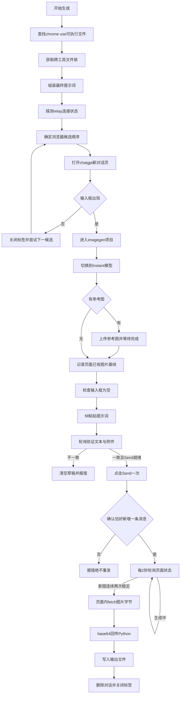

# web 后端完整调用链：从打开网页到保存图片

本文拆解 image-use 的 `web` 后端（默认后端）是如何一步步驱动 chrome-use，在你的
ChatGPT 网页里完成一次生图的。基于 image-use 0.34.5 源码（`image-use` 单文件脚本）逐函数走读整理。

## 0. 一句话类比

把整个过程想象成**遥控一个坐在你电脑前的助手**：

- **image-use** 是指挥官，只会在终端里喊命令；
- **chrome-use CLI** 是传令兵，把每条命令送到浏览器；
- **Chrome 扩展（relay）** 是助手的耳朵和手，真正替你动鼠标键盘；
- **页面内 eval 的 JS** 是助手的手指——所有"读页面""抓图片"的精细活，都是在
  chatgpt.com 页面自己身上执行的，凭据（cookie、accessToken）永远不出浏览器。

image-use 从不直接连 CDP、不发 HTTP 请求到 chatgpt.com（除了复用页面内 fetch）。
它对浏览器的全部控制面，就是反复 spawn `chrome-use` 子进程。

## 1. 控制通道的三个层次

| 层 | 谁 | 干什么 |
| --- | --- | --- |
| 编排层 | image-use（Python） | 决策、拼提示词、轮询、状态机、存盘 |
| 执行层 | chrome-use CLI 子进程 | `open` `fill` `click` `upload` `eval` `close` 六个动词 |
| 页面层 | 页面内执行的 JS 片段 | 读输入框状态、找图片、页面内 fetch 下载字节 |

调用约定：每次操作 = 一次 `subprocess.run([chrome-use, ...])`，`--session` 固定会话名；
`eval` 传一段 JS，页面内执行后 `return JSON.stringify(...)`，Python 侧解码两次
（先还原字符串、再 parse 成对象）。大段文本（提示词、长 JS）一律走 stdin，避开命令行长度限制。

为什么必须真浏览器而不是无头客户端：Cloudflare Turnstile 的交互式 token 只能由
真浏览器现场签发，单次有效；裸 HTTP 客户端过不了这一关。relay 连的是你日常登录的
Chrome，天然带着完整登录态。

## 2. 全流程总览



对应到一次真实运行的进度输出：

```
[   0.1s] relay connected
[   0.1s] opening ChatGPT via current Chrome (relay)     <- 候选选择并打开
[  10.8s] using current Chrome (relay)                    <- 输入框出现
[  13.8s] using project 'imagegen'                        <- 项目路由
[  22.3s] warning: model picker not found; leaving model as-is   <- 模型切换尽力而为
[  22.5s] pasting prompt                                  <- fill 粘贴
[  23.6s] verified prompt (675 characters) and 0 reference image(s)
[  62.1s] prompt submitted once                           <- Send 点击并被确认
[  64.2s] generating                                      <- 页面出现 Stop 按钮
[ 155.7s] receiving image                                 <- 出现新图 src
[ 157.8s] downloading image bytes                         <- 页面内 fetch
[ 166.6s] ✓ saved → drafts\project-intro.png  (1,853,762 bytes)
```

## 3. 分阶段详解

### 3.1 准备：找浏览器、拿锁、定会话（run_web 入口）

1. **找 chrome-use**：`shutil.which` 按 `chrome-use`（兼容旧名 agent-browser/abs）找可执行文件，找不到直接失败。
2. **跨工具锁**：整个生图回合持有 `~/.chatgpt-web.lock` 的文件锁（flock，0.5 秒轮询等待）。全机所有工具（本工具、chatgpt-use）共用一个叫 `chatgpt-web` 的 chrome-use 会话，同一时刻只有一个回合在碰 chatgpt.com——这是防限流的关键。拿不到锁原语的平台会警告降级。
3. **超时预算**：`--timeout` 的计时从**拿到锁之后**才开始，排队等待不占出图时间。
4. **提示词组装**：`_build_web_text` 把用户提示词和尺寸要求（如 "square image"）拼成最终文本。

### 3.2 选浏览器：候选顺序

先花一次 `chrome-use daemon status --json` 探测 relay 是否连着（10 秒超时），然后按
`auto` 模式排候选：**relay（你已打开的 Chrome）永远排第一**，后面跟着离线扫描出的
已登录 profile（Windows 上扫描不到，见 doctor 局限，但不影响 relay 路径）。
也可以 `--profile <名字>` 只试某一个，或 `relay`/`off` 只走当前 Chrome。

### 3.3 打开网页

```bash
chrome-use open https://chatgpt.com/ --session chatgpt-web
```

然后 `_wait_composer` 最多试 15 次：页面内 eval 一段 JS，检查两件事——

- 输入框（ProseMirror 编辑器）是否存在；
- 是否出现限流弹窗（`too many requests` 字样）——出现就直接报限流错误，不再干等。

输入框一直不出现，通常是**登录墙**（这个 Chrome 没登录 chatgpt.com）或被 Cloudflare
拦截，报错原文返回。每个候选失败后都 `chrome-use close` 收尾，绝不留僵尸标签页。

### 3.4 项目路由（默认 imagegen）

出图对话默认归进 ChatGPT 的 **Project**（类似文件夹），不散落在历史里：

1. 目标是项目 **URL** → 直接打开 `chatgpt.com/g/g-p-<32位hex>/project`；
2. 目标是**名字**（默认 `imagegen`）→ 在已认证页面内 fetch：
   - `GET /api/auth/session` 拿 accessToken（cookie 就在浏览器里，免费）；
   - `GET /backend-api/gizmos/snorlax/sidebar` 列出项目，按显示名精确匹配；
   - 没有就 `POST /backend-api/projects` 创建一个；
3. 打开项目页，等输入框出现。

路由是尽力而为：项目不可用就警告一声，退回普通对话继续。只有 `--require-project`
模式才强制失败。

### 3.5 模型切换（尽力而为）

"Pro" 档没有原生出图工具，所以要把输入框的模型菜单切到 Instant/Auto：

- 找 `aria-haspopup="menu"` 且文本像模型名的按钮（无稳定选择器，靠正则匹配）→ 点击；
- 在弹出的菜单项里按**精确文本**找 `Instant`，取坐标点击；
- 找不到就发一行 warning 继续跑（页面改版时常见，不影响出图）。

### 3.6 参考图上传（图生图才有）

- 本地路径直接用；URL 先下载成临时文件；
- `chrome-use upload <选择器> <文件...>` 把文件喂给输入框的附件入口；候选选择器逐个试，只有"元素没找到"或"歧义且尚未触发上传"才换下一个——**可能已经触发的上传绝不重试**，避免传两份；
- 轮询输入框状态直到：附件数量正确、缩略图已解码完成、Send 可用、无上传进度条。**传完才允许发送**。

### 3.7 图片基线（防认错图）

发送前先 eval 一段 JS，把页面上**已有的**图片 src 全记下来（匹配
`estuary/content | files/download | oaiusercontent`）。刚才上传的参考图也带
estuary URL，不记基线就会把它当成生成结果。

### 3.8 粘贴提示词并逐字验证（一次发送原则的核心）

这是整个链路里防御最重的环节：

1. **前置检查**：输入框必须为空。有残留草稿就报错退出（就是你遇到过的
   `composer is not empty`）——绝不覆盖用户自己的草稿；
2. **粘贴**：`chrome-use fill <输入框> --stdin`。fill 按段落插入、**不触发 Enter**，
   多段提示词不会被拆成几条消息发出去（`keyboard type` 就会踩这个坑）；
3. **逐字验证**（最多 30 秒，每秒一次）：
   - 用户消息条数没变（输入过程中如果消息数增加，说明文本意外被提交了，立即停止）；
   - 编辑器逻辑文本与提示词**规范化后逐字一致**（统一换行、去不换行空格）；
   - 附件数量一致；
   - Send 按钮可用且无忙态；
4. **验证失败 → 回滚**：普通模式把刚粘贴的文本清空（fill 空串），不留草稿堵下次；
5. **点击 Send 一次**。`--require-project` 模式更严格：点击前先在页面里注入一个
   "武装守卫"，把 Send 按钮替换成带随机 token 的受控按钮，点击后回收守卫的裁决——
   项目身份、文本、附件任一不对都发不出去；
6. **发送确认**（最多 30 秒）：输入框文本变空 且 恰好新增 1 条用户消息 → 确认成功。
   新增超过 1 条 → 报错；30 秒确认不了 → 报
   `could not confirm ChatGPT received the prompt; Send was not repeated`——
   **宁可报不确定，也不点第二次 Send**，因为重发可能双倍消耗出图额度。

### 3.9 轮询生成结果

发送后进入主循环（每 2 秒 eval 一次页面状态，直到 deadline）：

| 页面信号 | 判定 |
| --- | --- |
| Stop 按钮存在 | `generating`，继续等 |
| 限流弹窗 | 立即报错（提示词已提交，绝不自动降级 codex 双倍消耗） |
| 助手回复出现终结语（"You've hit the image generation limit" / "I can't generate that image." 等英文前缀） | 立即报配额/拒绝错误 |
| 出现**不在基线里**的新图 src | `receiving image`，进入确认 |
| 同一个新 src **连续两次**读到 | 确认完成，锁定该 src |
| 新图中途消失 | 清空连续计数，重新累计（防抓到半渲染图） |

注意：助手文字说完、Stop 按钮消失都**不能**证明出图结束——渲染可能滞后于文字，
唯一可信的信号就是那张稳定的新图。

### 3.10 页面内下载图片字节

锁定 src 后，eval `_JS_FETCH` 在**页面里**完成下载：

1. `fetch(src)`：
   - `blob:` 开头（2026-09 改版后的形态）→ 不带 credentials，因为 blob 只存在于铸造它的页面上下文里，外部永远读不到；
   - http(s) 的签名 URL → 带 `credentials: 'include'`，用浏览器自己的 cookie 过授权；
2. 拿到 Blob → ArrayBuffer → 按 0x8000 分块拼字符串 → `btoa` 转 base64 回传 Python；
3. blob 被吊销等异常时，兜底方案：找到页面上已解码的 ``，用 canvas
   `drawImage` 无损重编码成 PNG 再走同一打包流程。

为什么这么绕：图片字节只有页面自己拿得到，扩展进程和 Python 进程都读不了 blob:，
所以"在页面里下载、base64 带出来"是唯一通路。

### 3.11 清理与保存

1. **删除对话**（默认行为）：从 URL 提取 `/c/<id>`，页面内
   `PATCH /backend-api/conversation/<id>` `{is_visible: false}`（带 accessToken），
   对话从历史、侧栏、搜索里消失。失败只警告不失败——图已经到手了；
2. **关标签**：`chrome-use close`（`--keep-tab` 可保留），放在 finally 里，
   成功失败都会执行；
3. **写盘**：Python 侧 `base64.b64decode` 还原字节，写入 `-o` 指定路径，
   打印 `✓ saved → <路径> (<字节数>)`。

### 3.12 超时了怎么办：recover

超时只代表"确认失败"，图片可能还在页面上继续生成。报错会给出对话 URL，用：

```bash
image-use recover https://chatgpt.com/c/<id> -o out.png
```

它通过 chrome-use-sites 的 `chatgpt/images` 适配器回到那个会话把图捡回来，
不再重新提示词（避免二次消耗）。

## 4. 贯穿全程的四条设计原则

1. **绝不重发**：Send 只点一次；任何"结果不确定"都报错让人检查，而不是重试——
   重试的代价是双倍额度，比失败贵得多。
2. **验证先于行动**：粘贴后逐字比对、上传后确认解码完成、发送后确认恰好一条新消息，
   每一步都以页面真实状态为准，不做乐观假设。
3. **以页面为准的凭据**：cookie、accessToken、blob 下载全部留在页面内完成，
   token 永不落盘、不出浏览器。
4. **可观测的降级**：每一层失败（候选浏览器、项目路由、模型切换）都有明确的
   警告或错误输出，错误信息带 chrome-use 的原文，方便定位是登录墙、限流还是改版。

## 5. 与 codex 后端的一句对比

同一件事（生图），codex 后端不碰浏览器：直接读 `~/.codex/auth.json` 的 OAuth token，
POST `backend-api/codex/responses` 收 SSE 流里的 base64 图。它快、可传精细参数
（quality/background 等），但消耗 Codex 计量额度。web 后端慢一分钟、参数少，
但走聊天界面的出图额度——这就是默认 auto 模式优先 web、只在 web 不可用时才降级
codex 的原因。

## 引用说明

- 本仓库 `docs/how-it-works.md` / `how-it-works.zh-CN.md` — 两个后端的技术原理与 Cloudflare 防线分析
- 本仓库根目录 `image-use` 脚本源码 — `run_web`、`_submit_web_prompt`、`_generate_in_browser`、`_JS_FETCH`、`_JS_ENSURE_PROJECT`、`_JS_DELETE_CONV` 等函数（0.34.5）
- [chrome-use 仓库](https://github.com/leeguooooo/chrome-use) — relay 扩展、session/daemon、upload/eval 命令的实现方
- [chrome-use-sites 仓库](https://github.com/leeguooooo/chrome-use-sites) — `recover` 使用的 chatgpt/images 站点适配器
- [设计博客：让 Claude Code 自己画图](https://blog.leeguoo.com/en/posts/chatgpt-imagegen/) — 工具的设计动机与演进
